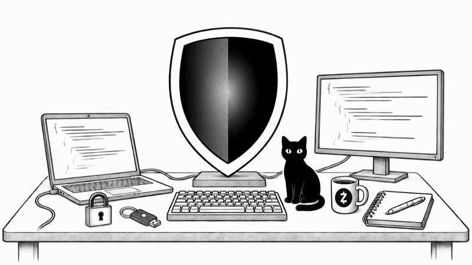

# Shielded Labs Workstation

A small Mac app to keep your own work in one place: open items, decisions,
dates, notes, links, and a page for each project or team chat you care about.



It is a personal tool, not a team system. Everyone gets an empty board and
fills it their own way.

## Private by design

- **Local only.** Your board lives in a folder on your Mac. There is no
  account, no server and no sync.
- **Nothing is sent anywhere by default.** The app makes no network
  connection unless you turn one on yourself.
- **Updates are checked only when you ask.** _Shielded Labs > Check for
  Updates…_ asks GitHub for the number of the latest release. It sends
  nothing about you or your board, and the app never checks by itself.
- **Three optional connections, all off until you set them up:**
  - _AI assistant_: your own key for Claude, OpenAI, Grok, Gemini, or a model
    running on your Mac. The text you paste, or your question together with
    what is in the app, goes to the service you chose.
  - _Calendar_: reads your meetings from a private iCal address. Read-only.
  - _GitHub_: reads open pull requests and issues of the repositories you
    list. Read-only.
- **Secrets stay in the macOS Keychain.** Your API key, GitHub token and
  calendar address are never written to a file.
- **This repository has no one's data.** It holds the code and an empty
  board. Personal files are listed in `.gitignore`.

## Yours to shape

- Create your own projects, deliverables and team chats.
- Rename anything, hide what you do not use, and drag the menu into your order.
- Edit or remove any row.
- Each person you mention gets a colour of their own, automatically.

## What is inside

| Page                               | What it is for                                                     |
| ---------------------------------- | ------------------------------------------------------------------ |
| Today                              | What is due, what is waiting on you, your projects at a glance     |
| Open items                         | Everything open, by group, with owner and due date                 |
| Decision board                     | What still has to be decided, by weight                            |
| Dates ahead                        | Dates worth remembering                                            |
| Projects, Deliverables, Team chats | One page each, created by you                                      |
| Quick reminders                    | A scratchpad                                                       |
| AI assistant                       | Ask about your board, or turn pasted notes into entries you review |
| Connections                        | Calendar and GitHub                                                |

There is also one search for everything (⌘K) and a short tour on first run.

## Install

You need a Mac with macOS 13 or later (Apple silicon or Intel) and the Xcode
command line tools (`xcode-select --install`).

```bash
git clone https://github.com/Michae2xl/sl_workstation.git
cd sl_workstation
zsh tools/app/build-app.sh
```

That compiles the app, runs its tests and installs it in `~/Applications`.
Open **Shielded Labs**, type your nick, and follow the tour.

The app is not signed with an Apple developer certificate. If macOS blocks
it, open System Settings > Privacy & Security and click **Open Anyway**.

To build a zip you can hand to someone else, without installing:

```bash
zsh tools/app/build-app.sh --package --no-install
```

The zip lands in `dist/`.

## Where your data is

```
~/Library/Application Support/Shielded Labs Workstation
```

Copy that folder to back up or move your board. Delete it to start over.
Updating the app never touches it.

## How it is built

- `tools/app/main.swift`: the Mac app. A window with a web view, plus
  the code that reads and writes the board files, the Keychain and the three
  optional connections. It has its own tests, run on every build.
- `tools/board.template.html`: the whole interface, in one file of plain
  HTML, CSS and JavaScript. No framework and no external resources.
- `tools/build.py`: puts the interface, the logo and the welcome art
  into one page.
- `tools/serve.py`: a local test server, bound to 127.0.0.1, to try
  the interface in a browser. The app itself runs no server.

The welcome illustration was generated with an AI image model from the
Shielded Labs shield.

## Contributing

Issues and pull requests are welcome. Before sending one, build the app with
`zsh tools/app/build-app.sh --no-install`: it compiles and runs the
tests without touching your installed copy. Keep personal boards out of
commits; the data files are in `.gitignore` for that reason.

If you find a security problem, please report it privately through GitHub's
"Report a vulnerability" on this repository instead of opening a public issue.

## License

The code is under the [MIT License](LICENSE).

The Shielded Labs name, the shield and the welcome illustration made from it
are not covered by that license. They belong to Shielded Labs and are used
here to identify the project.

## Status

Early and personal. It works for daily use on one Mac. It has not been tested
widely on other machines, so if something breaks on yours, please tell me
where.
